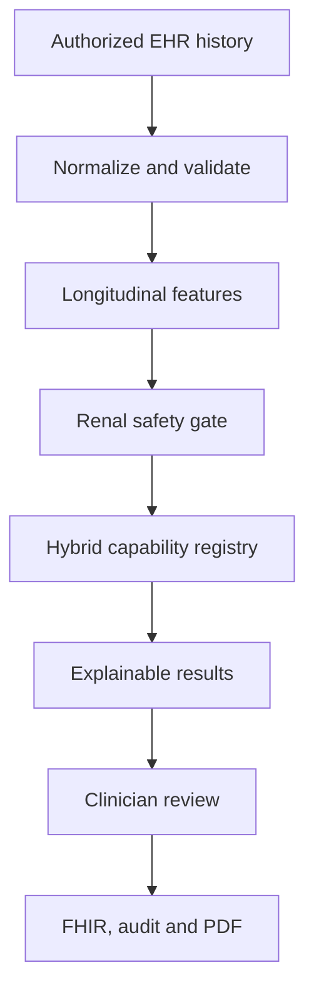

# GovCare EHR — Predictive Clinical Intelligence V40

Implementation and verification report — 2026-10-08

The delivered system is positioned as an **EHR-integrated, longitudinal, explainable, auditable, clinician-controlled Predictive Clinical Intelligence System**. It is not an autonomous diagnosis system and does not invent disease probabilities.

## 1. Project Identification

GovCare EHR is a full-stack clinical application with:

- React 19, TypeScript 6 and Vite 8 frontend.
- Spring Boot 3.5 / Java 21 API with Spring Security, JWT, JDBC/`SqlSupport`, PostgreSQL and Flyway.
- HAPI FHIR R4 resources and provenance storage.
- Existing CKD assessment, embedded logistic classification, clinical observations, reports, patient access controls, audit, PDF generation and clinician workflows.
- A separate FastAPI boundary prepared for future governed equations or research-model adapters.

The V40 scope upgrades the existing CKD workspace; it does not replace the application or create an isolated demo UI.

## 2. Existing Architecture

The inherited V39 package already contained the AppRouter/AppShell, role-driven navigation, integrated CKD workspace, authorized patient selector, clinical observation schema, CKD assessment service, predictive snapshot tables, FHIR storage, PDF reports, audit records and a preliminary forecasting runtime.

The pre-change audit is recorded in `docs/PREDICTIVE_V40_ARCHITECTURE_AUDIT.md`. The route `/ai-cdss/ckd/predictive-intelligence` already redirected into the authorized CKD workspace view, allowing V40 to preserve navigation and patient context instead of duplicating them.

## 3. Problems Found

- The earlier trajectory runtime could present narrow or zero-width ranges and used ambiguous time-origin behavior.
- Two-point history was not clearly separated from statistically estimable prediction intervals.
- The earlier renal gate did not cover the full set of stale, contradictory, provenance, recent-admission and abrupt-change conditions.
- Hyperkalemia and anemia capabilities were placeholders rather than transparent current-data review modules.
- Model lifecycle, applicability, local validation and operational monitoring metadata were incomplete.
- Longitudinal retrieval logic was embedded in the orchestration service and did not fully validate FHIR subject/provenance.
- Read access, unavailable-model events, safety triggers and generated reports required stronger predictive-specific audit evidence.
- The PDF lacked a complete measured-versus-projected chart, 3/6/12-month table, current monitoring status and data limitations.
- The FastAPI scaffold needed explicit registry/governance gates, service authentication, sanitized validation errors and null-valued `NOT_INSTALLED` contracts.
- Older regression scripts assumed that the superseded V37 runtime remained active.

## 4. Root Cause Analysis

The main cause was not a missing UI component. The previous implementation mixed three different concepts—measured clinical state, statistical trajectory and future outcome probability—without a single governed availability contract. Data retrieval, safety, forecasting and presentation therefore made partly independent assumptions.

V40 resolves this by making authorized longitudinal evidence the single source, running quality and renal-safety gates before projection, requiring an active registry entry, and preserving explicit method/validation/runtime metadata through API, database, UI, FHIR and PDF outputs.

## 5. Target Architecture

The hybrid registry distinguishes `TREND_PROJECTION`, `RULE_BASED`, `VALIDATED_EQUATION` and `RESEARCH_MODEL`. Runtime results fail closed as `INSUFFICIENT_DATA`, `NOT_INSTALLED` or `BLOCKED_BY_SAFETY_GATE` when their prerequisites are not satisfied.

## 6. Features Implemented

- Authorized retrieval of real GovCare clinical observations, verified lab results and patient-linked FHIR Observations.
- Normalization and longitudinal summaries for eGFR, creatinine, ACR, blood pressure, HbA1c, glucose, potassium, hemoglobin, BUN/urea, BMI, weight and lipids.
- Original value/unit/reference-range provenance retained alongside normalized values.
- Latest, previous, baseline, change, percentage change, 30/90/180/365-day windows, slope, observation counts, dates, freshness and direction.
- Data completeness, quality level and explicit missing/stale/invalid/duplicate/conflicting/provenance flags.
- Renal safety gate and 3/6/12-month patient-specific eGFR projections.
- Kidney-failure equation and cardiovascular equation adapter seams that remain `NOT_INSTALLED` with null risk values.
- Rule-based current potassium monitoring and adult anemia review signals; neither is a future probability or diagnosis.
- Six integrated status cards, measured/projected chart, explainability dialog, quality panel, timeline and review queue.
- Accept/Modify/Defer/Dismiss review with reason category, narrative reason, optional clinical note, optimistic locking and idempotency key.
- Operational model counters without automatic retraining or deployment.
- FastAPI catalogue for seven future outcome adapters; every production entry currently fails closed as `NOT_INSTALLED`.

## 7. Frontend Files Modified

- `src/pages/PredictiveClinicalIntelligence.tsx` — integrated dashboard, safety/empty states, six status cards, explainability, review fields and verified-measurement flow.
- `src/components/ai/KidneyTrendChart.tsx` — measured solid series, projected dashed series, interval, calculation-time origin and CKD category guides.
- `src/components/ai/predictive-intelligence.css` — responsive six-card dashboard, explanation/review styles and two-column mobile quality statistics.
- `src/services/predictiveIntelligenceService.ts` — strict methods/statuses/categories, longitudinal DTOs, overview/risk/forecast APIs and structured review payload.

The existing CKD workspace, `AuthorizedPatientSelect`, patient context, route guard, shared buttons/cards, API client and deep-link alias were reused.

## 8. Backend Files Modified

Core Spring files:

- `ClinicalIntelligenceEngine.java`
- `LongitudinalClinicalFeatureService.java`
- `PredictiveIntelligenceService.java`
- `PredictiveIntelligenceController.java`
- `CkdAssessmentReportService.java`
- `predictive/ClinicalDataQualityService.java`
- `predictive/RenalSafetyGateService.java`
- `predictive/CkdProgressionForecastService.java`
- `predictive/MonitoringSignal.java`
- `predictive/HyperkalemiaRiskService.java`
- `predictive/AnemiaRiskService.java`
- `predictive/KidneyFailureRiskCalculator.java`
- `predictive/CardiovascularRiskCalculator.java`
- `predictive/PredictiveRiskAdapter.java`

The FastAPI scaffold is now split into `app/main.py`, `adapters`, `registry`, `schemas`, `monitoring` and `models`, with pinned runtime/test requirements and contract tests.

Tests and verification scripts were extended for trajectory boundaries, safety thresholds, PDF content, registry inactivity, cross-scope access, model fail-closed behavior, monitoring counters and V39→V40 upgrades.

## 9. Database Migration

`V40__governed_predictive_intelligence.sql` is additive and preserves existing data.

- Extends `predictive_model_registry` with outcome, horizon, reference, applicability, activation/retirement and validation-review metadata.
- Retires `egfr_trajectory / trend-linear-1.0` without deleting it or its linked historical snapshots.
- Registers `trend-linear-2.0` as the active statistical trajectory runtime.
- Registers renal-safety, potassium and anemia rule modules plus an explicit hospitalization `NOT_INSTALLED` adapter.
- Adds method/version/validation/completeness/latency provenance to forecast snapshots.
- Adds constrained clinician reason codes and clinical notes.
- Adds tenant-owned daily operational model monitoring with non-negative counters, missing-input rate, latency, status distribution, model version and drift status.
- Adds indexes and foreign keys without replacing canonical V1–V39 tables.

The complete 39-file inherited migration chain through V40 was applied to a clean PGlite database. A separate V39 fixture with an immutable V37 forecast was upgraded to V40; the historical forecast and v1 model reference remained unchanged.

## 10. API Changes

All endpoints use server-side principal, hospital and patient scope and return `Cache-Control: no-store`.

| Method | Endpoint | Purpose |
|---|---|---|
| GET | `/api/ai-cdss/ckd/patients/{patientId}/predictive-intelligence` | Complete governed overview |
| GET | `/api/ai-cdss/ckd/patients/{patientId}/trends` | Normalized longitudinal trends |
| GET/POST | `/api/ai-cdss/ckd/patients/{patientId}/forecast/ckd-progression` | Preview or persist a 3/6/12-month projection |
| GET | `/api/ai-cdss/ckd/patients/{patientId}/risk/{riskKey}` | Outcome/rule capability status |
| GET | `/api/ai-cdss/ckd/patients/{patientId}/data-quality` | Evidence quality |
| GET | `/api/ai-cdss/ckd/patients/{patientId}/timeline` | Authorized clinical/review timeline |
| POST | `/api/ai-cdss/ckd/predictive-recommendations/{id}/review` | Clinician review alias |
| POST | `/api/ai-cdss/ckd/patients/{patientId}/observations` | Verified dated measurement with provenance |

FastAPI exposes `/health`, `/models`, `/models/{modelKey}`, `/predict/{modelKey}` and the safe legacy `/predict`. All non-health calls require `X-Service-Token`.

## 11. Forecasting Logic

`trend-linear-2.0` is an ordinary least-squares extrapolation of valid, dated, normalized patient eGFR observations.

- Requires at least two points spanning at least 90 days; two points yield a low-reliability point estimate without an invented interval.
- Uses calculation time as forecast origin and adds 3, 6 or 12 calendar months for the target date.
- For three or more points with non-zero residual variance, displays an approximate 95% Student-t prediction interval.
- Does not clip a negative or implausibly high projection into a plausible number; it suppresses the result.
- Reliability is based on evidence count, observation window, completeness and whether an interval is estimable.
- Direction/severity are descriptive trajectory signals. No deterministic future CKD stage or disease probability is produced.
- Registry inactivity returns `NOT_INSTALLED` before the calculator runs.

## 12. Safety Logic

Long-term projection is blocked when evidence suggests that chronic extrapolation is unsafe or unsupported.

- Creatinine increase of at least 0.3 mg/dL within 48 hours or at least 1.5× within seven days is labeled as a laboratory AKI review criterion, not a diagnosis.
- Recent eGFR fall greater than 20% within 30 days triggers rapid-change review.
- Missing or stale eGFR/creatinine, less than 90 days of history, pediatric or implausible age, conflicting values, wrong units, missing dates/provenance, contradictory FHIR subject, unreadable FHIR data, truncated history and active/recent admission can suppress forecasting.
- Medication information is explicitly unreconciled; actual use, adherence, stopped/non-prescription medicines, acute illness, volume status and dehydration are not inferred.
- Potassium categories use current-value review thresholds: `<5.5 LOW`, `5.5–5.9 MODERATE`, `6.0–6.4 HIGH`, `≥6.5 CRITICAL` mmol/L.
- Anemia uses the source laboratory lower reference limit when available. Adult sex-specific screening fallbacks are used only when recorded sex supports them; transparent concern bands are GovCare prioritization rules, not a validated outcome model or CKD-anemia diagnosis.

## 13. FHIR Changes

- Available eGFR projections are persisted as `RiskAssessment`, never as laboratory `Observation`.
- Forecast method, horizon, model version, validation/local-validation, reliability, interval method and projected quantities are carried as structured extensions.
- Each forecast has `Provenance` linking the actor and immutable predictive snapshot.
- Clinician review creates a `ClinicalImpression` plus `Provenance`; it does not create an order, diagnosis or referral.
- Manually entered verified evidence creates an `Observation` plus `Provenance`, retaining the actual measurement date and source note.
- Generated reports create HAPI-serialized `DocumentReference` and `Provenance`, including method/model/validation extensions. Dynamic values are serialized rather than concatenated into JSON.

## 14. PDF Changes

The CKD report now includes a longitudinal predictive appendix with:

- current recorded G/A categories, latest eGFR/creatinine and data completeness;
- dated historical eGFR table;
- solid measured line, dashed projected line, interval bars and eGFR category guides;
- 3/6/12-month forecast table with status, reliability and interval method;
- current risk/rule capability table with method, version and validation status;
- renal-safety reasons, data-quality flags and medication limitations;
- clinician-controlled recommendation/review states;
- footer: “Clinical decision support only. Forecasts and risk estimates are not autonomous diagnoses.”

PDF regression tests extract and verify the generated text and verify the measured/projected appendix.

## 15. Security Changes

- `ClinicalPatientAccess` runs before clinical queries or writes.
- UUID parsing is server-side; hospital, role and permission are taken from the authenticated principal, not request claims supplied by the UI.
- Cross-hospital and unassigned-patient access fails before data retrieval.
- Review/measurement/PDF writes require clinical-write scope.
- Recommendation updates use optimistic version checks, evidence fingerprints and idempotent request UUIDs.
- Predictive reads/generation, unavailable models, safety gates, reviews, verified measurements and PDFs are audited with patient, hospital, actor, action, model/version and output status where applicable.
- FastAPI uses constant-time service-token comparison, returns degraded health when authentication is unconfigured and sanitizes validation/adapter errors without echoing patient values.
- Model registry active/reviewed/metadata gates are authoritative; inactive or unreviewed adapters are not executed.

## 16. Tests Performed

| Verification | Result |
|---|---:|
| Spring/JUnit full suite | 98 passed, 0 failed |
| Predictive domain checks | 53 passed |
| FastAPI contract/security tests | 9 passed |
| Predictive access tests | 24 passed |
| Integrated CKD workspace tests | 30 passed |
| Role/access regression tests | 45 passed |
| Disease-probability UI contract tests | 21 passed |
| Disease-probability Java checks | 30 passed |
| Predictive clean/upgrade migration checks | 29 passed |
| Disease-probability migration checks | 26 passed |

Covered cases include one/two/multiple eGFR points, 89/90-day boundary, forecast origin, no invented two-point interval, AKI boundary, potassium/anemia thresholds, stale data, unit/date/provenance rejection, duplicates/conflicts, tenant isolation, registry inactivity, null probabilities, clinician feedback constraints, immutable audit/history, FHIR/PDF representation and operational status-count increments.

The private authenticated browser suite was not executed because `GOVCARE_VISUAL_ACCOUNTS` was not supplied. The harness correctly stopped before login or patient access. No credentials or patient identities were invented to bypass that control.

## 17. Build Result

- `npm run build`: **PASS** — TypeScript and Vite production build, 3,426 modules transformed.
- `mvn package`: **PASS** — 98 tests and executable `govcare-ehr-api-1.0.0.jar` generated.
- FastAPI import/tests/health and `NOT_INSTALLED` behavior: **PASS**.
- Flyway ordering, clean application and V39→V40 preservation: **PASS** in isolated PostgreSQL-compatible PGlite.
- Existing CKD/workspace/role/disease-probability regression suites: **PASS**.

Generated dependency folders and build outputs are deliberately excluded from the source delivery ZIP; reproducible lockfiles and build definitions are included.

## 18. Known Limitations

- No live hospital PostgreSQL migration, real-patient workflow or authenticated visual browser run was performed in this workspace.
- The statistical trajectory assumes a linear relationship over the observed period; it is not a causal or biological progression model.
- A prediction interval is unavailable for two points or zero residual variance and is suppressed when it exceeds configured display plausibility guardrails.
- Medication context is prescription-record context, not confirmed reconciliation or adherence.
- Acute illness, symptoms, ECG, fluid/dehydration state and over-the-counter exposure are not reliably structured in the current EHR model.
- Operational monitoring counts usage/latency/missingness/status distribution; it does not establish accuracy, calibration, fairness or clinical benefit.
- Local `urn:govcare:*` FHIR extensions should be formalized in a published implementation guide before cross-organization exchange.
- No automatic retraining, autonomous deployment, medication change, diagnosis, referral or order is performed.

## 19. Clinical Validation Limitations

No representative Sri Lankan longitudinal CKD dataset was available. Therefore:

- No CKD progression, kidney failure, future AKI, cardiovascular, hyperkalemia, anemia or hospitalization probability was trained, calibrated or claimed.
- KFRE and cardiovascular calculations remain `NOT_INSTALLED`; 2-year and 5-year values remain null.
- Trend projection is labeled `STATISTICAL_PROJECTION_NOT_CLINICALLY_VALIDATED` with local validation `NOT_APPLICABLE` because it is patient-specific extrapolation, not a population probability model.
- Rule modules are labeled `CLINICAL_RULE_NOT_PROBABILITY / NOT_LOCALLY_VALIDATED` and require clinical interpretation.
- The system is not approved here as a medical device or clinical replacement. Deployment requires local governance, privacy, safety, usability and prospective clinical review.

## 20. Future Sri Lankan Dataset Integration Plan

1. Establish data-governance approval, lawful basis, de-identification, access controls and a versioned data dictionary.
2. Define intended use, target population, outcomes, horizons, exclusions and action pathways with Sri Lankan nephrology and primary-care stakeholders.
3. Build a provenance-preserving longitudinal cohort; quantify missingness, site effects, assay/unit changes and label quality.
4. Split by patient, time and facility; keep an untouched external/site validation set and prevent leakage.
5. Evaluate candidate published equations before ML. Document licensing, applicability and baseline transportability.
6. If a research model is justified, register it as `RESEARCH_MODEL / NOT_LOCALLY_VALIDATED`; report discrimination, calibration, decision curves, subgroup performance and uncertainty.
7. Recalibrate only with a prespecified plan. Compare against current care and simple baselines; do not optimize on the test set.
8. Conduct retrospective external validation, silent prospective validation, clinician usability/human-factors testing and monitored pilot deployment.
9. Approve a versioned threshold/action policy, model card, FHIR profile, rollback plan and post-deployment monitoring plan through governance.
10. Activate the reviewed adapter in the registry without changing the UI/API architecture; retain immutable prior versions and snapshots for audit and rollback.

This architecture allows future recalibration or replacement of a reviewed model without redesigning the EHR module and without converting unavailable evidence into fabricated certainty.
