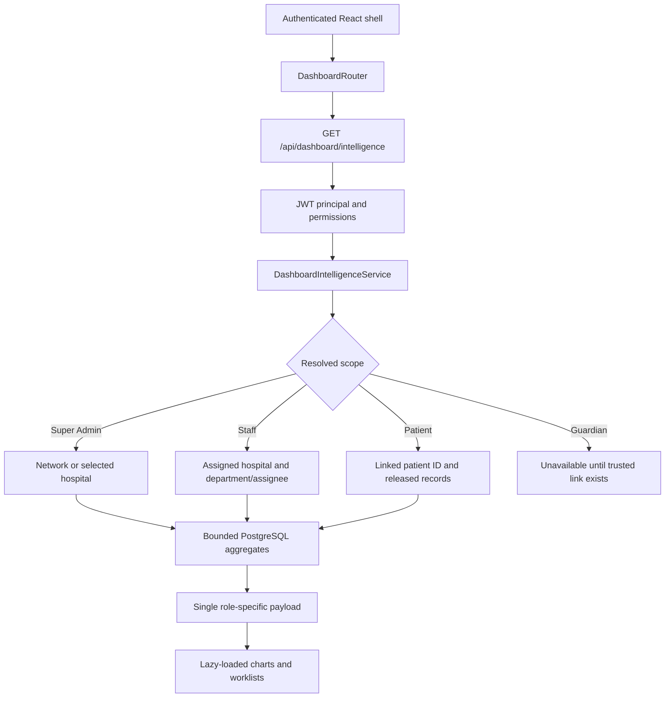

# GovCare Role Intelligence Dashboard Architecture

## 1. Objective

This release replaces the shared, generic landing dashboard with a server-selected hospital operations intelligence layer. The authenticated JWT principal determines the dashboard experience, query scope, available actions, and privacy boundary. The browser never supplies a role to the dashboard API.

The design preserves the existing React application, Spring Boot API, PostgreSQL/Flyway database, JWT authentication, database-backed RBAC, FHIR endpoints, CKD AI-CDSS workflows, and GovCare dark-green visual identity.

## 2. Runtime architecture



### Trust boundary

1. `JwtAuthenticationFilter` establishes `GovCarePrincipal`.
2. `DashboardController` passes that principal and an optional hospital selector to the service.
3. `DashboardIntelligenceService.profileFor(...)` maps the authenticated database role to a dashboard profile.
4. `resolveScope(...)` rejects cross-hospital requests and resolves network, hospital, department, clinician, or patient-self scope.
5. Every SQL statement is parameterized. Hospital-, doctor-, department-, or patient-specific predicates are applied on the server.
6. The response contains only the data required by that dashboard. The React role mapping is navigation and presentation support, not the security boundary.

## 3. Dashboard experiences

| Experience | Database role(s) | Primary operational purpose |
| --- | --- | --- |
| Super Admin | `super_admin` | Network comparison, adoption, authentication, audit, and selected-hospital command view |
| Hospital Admin | `hospital_admin` | Capacity, patient flow, diagnostics workload, medicine risk, and operational alerts |
| Doctor | `doctor`, `surgeon`, `anesthetist` | Assigned workload, consultations, reports, diagnosis patterns, and governed CKD risk signals |
| Nurse | `nurse` | Source-readiness view; assignment, MAR, vitals and shifts remain unavailable until authoritative records exist |
| Front Desk | `receptionist` | Registration, appointments, queue volume, waiting time, and live tokens |
| OPD | `opd_officer` | OPD queue throughput, priority mix, waiting time, and current worklist |
| Ward | `ward_manager` | Department-scoped admissions, bed status, discharge work, and transfers |
| Laboratory | `lab_technician`, `lab_manager`, `pathologist` | Received, processing, completed, verified, critical result, and turnaround analytics |
| Radiology | `radiology_technician`, `radiologist` | Modality volume, workflow status, emergency priority, reporting queue, and turnaround |
| Pharmacy | `pharmacist` | Prescription workflow, dispensing, medicine consumption, stock, and expiry |
| Inventory | `inventory_officer` | Item totals, reorder risk, expired stock, stock levels, consumption, and expiry windows |
| Finance | `finance_officer` | Safe source-readiness view until a governed billing ledger is implemented |
| Records | `records_officer` | Registration, demographic completeness, duplicate-risk workflow, and record activity |
| Patient | `patient` | Own appointments, released prescriptions/reports, and personal clinical timeline |
| Guardian | `guardian` | Safe source-readiness view until authenticated guardian-to-patient linkage exists |
| Emergency | `emergency_staff` | Existing emergency-priority queue/admission signals; triage limitations are explicit |
| Quality | `quality_officer` | Critical result, cancellation, discharge, audit, and operational quality indicators |
| IT | `ict_admin` | User, authentication, failed-login, and audit activity; telemetry gaps are explicit |
| Mortuary compatibility | `mortuary_officer` | Explicit unavailable state because no governed mortuary event source exists |

## 4. API contract

### Endpoint

```http
GET /api/dashboard/intelligence
GET /api/dashboard/intelligence?hospitalId=<uuid>
Authorization: Bearer <JWT>
Cache-Control: no-store
```

`hospitalId` is accepted only as a Super Admin network selector or when it equals the staff member's assigned hospital. It never changes the authenticated role.

### Response shape

```json
{
  "schemaVersion": 1,
  "dashboardKey": "doctor",
  "role": "doctor",
  "title": "Clinical decision workspace",
  "subtitle": "...",
  "capturedAt": "2026-09-30T12:00:00+05:30",
  "refreshAfterSeconds": 60,
  "scope": {
    "level": "hospital",
    "hospitalId": "uuid",
    "hospitalName": "Hospital name"
  },
  "metrics": [],
  "charts": [],
  "worklists": [],
  "alerts": [],
  "unavailableCapabilities": []
}
```

Each metric and visualization carries an `available` flag. An unavailable item has a null value plus a machine-readable reason such as `no_source`, `no_data`, `not_authorized`, `identity_link_missing`, or `data_error`. This prevents a missing source from being represented as a real zero.

## 5. Data-source policy

Dashboard values come only from existing PostgreSQL records reached through parameterized Spring JDBC queries. A value of zero appears only when an aggregate query proves that the count is zero for a defined period and scope. A missing table, missing identity relationship, query failure, or unsupported workflow is represented as unavailable.

Verified source families include:

- hospitals, users, roles, permissions, login activity, and audit logs;
- patients, appointments, visits, OPD queue, consultations, admissions, wards, and beds;
- laboratory requests/results and radiology requests/results;
- prescriptions, pharmacy receipts, medicines, and stock batches;
- CKD and deterioration assessments where the clinician is already authorized for the patient;
- released patient-facing reports and prescriptions.

Known source gaps intentionally not inferred:

| Capability | Why it is unavailable |
| --- | --- |
| Historical availability and API response time | No persisted request-duration or uptime time series |
| Nurse assignment, observation tasks, shift plans, and MAR | No authoritative shift/task/MAR assignment model |
| Finance revenue, claims, invoices, or payments | No billing ledger in the supplied database |
| Emergency triage encounters | No triage encounter model; only existing urgent queue/admission signals are used |
| Guardian portal analytics | No authenticated `app_user` to guardian/patient relationship |
| Patient CKD risk release | CKD predictions have no patient-release flag |
| Supplier order trend | No supplier purchase-order model linked to the current stock schema |
| Mortuary events | No governed mortuary event model |

## 6. Privacy and authorization rules

- Super Admin: network aggregates or one explicitly selected hospital; the dashboard aggregation API does not return patient-level network lists. The separate network patient directory and AI patient selector now provide permission-checked patient access across hospitals; see [SUPERADMIN_NETWORK_ACCESS_FIX.md](SUPERADMIN_NETWORK_ACCESS_FIX.md).
- Hospital Admin and operational teams: `hospital_id` is always taken from the authenticated scope.
- Doctor: appointments, visits, consultations, reports, and risk signals are constrained to `doctor_id`, `requested_by`, or an existing assigned visit.
- Nurse: no patient worklist is returned because the supplied schema cannot prove nurse assignment. Only permission-gated ward aggregates are shown.
- Ward Manager: department filter is applied when the account has a department assignment.
- Patient: `actor.patientId` is mandatory; worklists use only that patient and released clinical records.
- Guardian: no records are returned until a trusted authenticated link exists.
- Super Admin hospital selection is validated against active hospitals.
- Every role must hold at least the relevant operational permission; `DASHBOARD_VIEW` enables the dashboard route, while the underlying workflow permissions govern the content.

## 7. Performance design

- One aggregation request drives each dashboard load.
- Server-side counts, grouping, time bucketing, and limits avoid transferring raw records for client calculation.
- Flyway V31 adds bounded indexes aligned with hospital, time, role, assignee, and workflow predicates.
- React Query uses a 60-second refresh/stale window, zero retained dashboard cache after unmount, one retry and manual refresh. Cache keys include the complete authorization context.
- Recharts is isolated behind `React.lazy`, producing a separate chart bundle.
- Worklists and hospital comparisons are limited and sorted server-side.
- `Cache-Control: no-store` prevents sensitive dashboard payloads from being retained by intermediary caches.

## 8. Presentation system

The new dashboard surface uses the existing dark-green healthcare identity with restrained glass cards, operational status tones, responsive worklists, command-center hierarchy, and reduced-motion support. Charts include a screen-reader table. Worklists become stacked cards on narrow screens and tables at larger breakpoints.

Responsive breakpoints and intended behavior:

| Width | Behavior |
| --- | --- |
| 375 px | Single-column KPIs, stacked worklist cards, wrapped command actions |
| 768 px | Two-column KPI grid and standard navigation behavior |
| 1366 px | Four-column KPI grid and balanced analytics panels |
| 1920 px | Two-column chart/worklist command-center layout with bounded content width |

## 9. Database and API changes

### Flyway V31

- Adds `opd_officer`, `ward_manager`, `inventory_officer`, `finance_officer`, `emergency_staff`, and `quality_officer` to `user_role`.
- Inserts matching RBAC role rows without replacing existing roles.
- Adds dashboard, inventory, finance, emergency, quality, and system-monitor permissions.
- Maps least-privilege workflow permissions for the six new roles and assigns `DASHBOARD_VIEW` to dashboard-capable roles.
- Changes staff default routes to `/` and preserves `/portal` for patients and guardians.
- Adds dashboard-oriented partial/composite indexes.

### Spring API

- Adds `DashboardIntelligenceService` and `GET /api/dashboard/intelligence`.
- Preserves `GET /api/dashboard/overview` and its response shape for hospital administration; other roles must use the scoped endpoint.
- Extends `UserRole` and staff-management role options additively.
- No existing FHIR, CKD AI-CDSS, authentication, or workflow endpoint was removed.

## 10. Safe extension sequence

When adding a future dashboard metric:

1. Identify an authoritative persisted source and define the exact time and scope semantics.
2. Add the required RBAC permission and index through a new Flyway migration.
3. Add a server-side query with mandatory hospital/assignment/patient predicates.
4. Return an unavailable item if the source cannot prove the value.
5. Add a contract test and privacy test before exposing it in the role definition.
6. Add patient-facing data only after an explicit release state exists.
## Access consistency update (V32)

The frontend uses one explicit path policy in `src/lib/roleAccess.ts` for route guards, sidebar links,
search navigation and dashboard quick actions. Unknown paths are denied. Shared profile/password
pages are available to every active role without granting clinical or administrative permissions.

V32 repairs mismatched role foreign keys and default routes, keeps canonical role codes, and adds
existing OPD registration / emergency capacity permissions. Staff options derive from the Java enum.
Temporary password handling applies to all roles. API profiles refresh on focus and every 60 seconds;
role, tenant, department, patient identity or permission changes clear query and clinical caches.
Dashboard builders require their content permissions in addition to DASHBOARD_VIEW.
Local test account setup is separate from migrations and never changes an existing password.

See ACCESS_ROLE_FIX_REPORT.md, ACCESS_ROLE_BUILD_INSTRUCTIONS.md and ACCESS_ROLE_TESTING_REPORT.md
for the current delivery and validation status.
